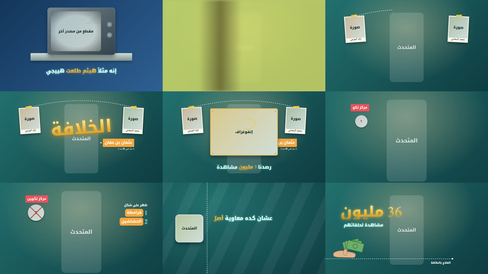

# مراجع الأسلوب (دراسة فيديوهات يعجب بها المستخدم)

> للاستخدام عند اختيار التصميم. القيود الثابتة في `PREFERENCES.md` تسبق أي مرجع: لا نساء، لا موسيقى، لا أسود، خلفية داكنة مزخرفة أو صورة مناسبة، ولا شيء يغطي الوجه.
> آخر تحديث: 2026-10-19

## مرجع لوحة المونتاج المرسلة (2026-10-19)

هذه صورة ثابتة أرسلها المستخدم: تلفاز يعرض مقطعاً من مصدر آخر، صور مثبتة تصل بينها أقواس منقطة، كلمة مفتاحية كبيرة، بطاقة مصدر في الوسط، شارة تصنيف وقائمة مرقمة، ثم لوحة متحدث مع عداد ورسمة نقود وخط مصدر. تُستخدم لتذكّر أنواع العناصر وتوزيعها. الصورة لا تحدد توقيت الحركة أو مدتها. طبّق ألوان الخلفية الأحدث من `PREFERENCES.md`، لا خلفيات المرجع الفاتحة أو السادة.

## مرجع المونتاج العرضي — EU-Protests-Landscape (2026-10-19)

قال المستخدم إن هذا الفيديو كان أفضل ما أُنجز. **حُسم 2026-10-24:** يُدرس منه **أسلوب النصوص المكتوبة**، أما تقسيمه (المتحدث في بطاقة يميناً والكتابة على ورق يساراً) فلا يُنقل: البطاقات تُعرض فوق فيديو الشيخ كاملاً وفق «لوحة الكتابة» في `PREFERENCES.md`. الفيديو النهائي: `G:ملفاتيجاهزعرضيأساسيةاشتعال أوروبي - مظاهرات في فرنسا وإيطاليا وبلجيكا.mp4`، وكوده المحفوظ: `backups/pre_unused_cleanup/src/EuLandscape.tsx` (لا يُستورد).

### أسلوب النصوص المكتوبة (دراسة 20 لقطة + الكود، 2026-10-24)
- **بنية المشهد المكتوب:** عنوان أولاً ← بطاقة لكل بند يقوله ← ختم الخلاصة. البطاقات تتراكم في **عمود واحد** (3–5 بطاقات) ولا يُمحى ما سبق حتى ينتهي المشهد، ثم يخرج الكل معاً.
- **العنوان (`Banner`):** شريط داكن بزوايا مستديرة، خط كوفي 800 فاتح، 40–60 بكسل، سطر واحد لا يلتف. صيغه: «إيطاليا: ضيق المعيشة»، «بلجيكا: ضد داعش»، أو سؤال الشيخ نفسه «أين تذهب الأموال؟»، «لماذا تُضخّ هذه الأموال؟». العلم في طرفه عند ذكر بلد.
- **البطاقة (`StatRow`):** ورقة فاتحة بمشبك أحمر صغير أعلاها، ميلان متبادل −1°/+1°، تنزلق من اليسار مع نابض عند **أول كلمة البند**. يمين البطاقة مربع ملوّن بأيقونة خطية ترسم نفسها، ثم **العبارة بكلماته مختصرة** (≤ 6 كلمات، كوفي 800 نحو 40 بكسل)، وتحتها سطر صغير رمادي للتوضيح أو التاريخ أو التصحيح، ويسارها **الرقم الكبير بلون التمييز يعدّ صعوداً** والوحدة تحته والعلم بجانبه.
- **لغة العبارات:** من كلامه لا من صياغة المونتير، مع إبقاء «و» الوصل بين البنود لتُقرأ جملة واحدة متتابعة: «ضيق في المعيشة / الأسعار غالية / والرواتب لا تكفي»، «تدخّل الدول في الحروب / وإنفاق دولهم عليها / بينما شعوبهم في ضوائق مالية». الأرقام: «فرنسا: عملية «شمال» 2025 — 322 مليون يورو».
- **الختم (`Stamp`):** عبارة عاطفية قصيرة تختم القائمة («والشعوب تغلي»، «أرقام صادمة»، «مظاهرات كبيرة جداً») مائلة أسفل العمود. فوق الفيديو يحتاج خلفية فاتحة ليُقرأ (`StampV` في التجربة).
- **المصدر (`Sources`):** شريط فاتح أسفل جهة الكتابة: «المصدر:» ثم الرابط بخط ثابت العرض، يتبدّل مع كل رقم.
- **الشريط الدائم:** وسم الموضوع (#أوروبا_تحترق) في الزاوية، وشريط العنوان والمؤقت أسفل.
- **أخطاء رأيتها في الفيديو لا تُكرَّر:** (1) العنوان يظهر وحده ثوانٍ والعمود فارغ (2:05، 4:10) — اجعل البطاقة الأولى تدخل خلال ثانية من العنوان أو أخّر العنوان إلى كلمتها؛ (2) الرقم يظهر «0» قبل أن يُنطق (بطاقة F-16 عند 3:50) — **أُصلح 2026-10-24:** `Count` في `EuKit` صار لا يظهر قبل `countAt` ويحتفظ بمكانه، فضع `countAt` عند نطق الرقم نفسه؛ (3) صندوق العبارة البرتقالي/الأزرق في اللقطات الكاملة — مرفوض الآن، العبارة بلا صندوق.
- **التجربة التدريبية:** `EuText-Practice` (`src/EuTextPractice.tsx`، مجلد Demos): بطاقات EU فوق فيديو الشيخ كاملاً في الجهة الخالية بلا تقسيم، ثم عبارات بلا صندوق. استحسنها المستخدم 2026-10-24.

---

## ١) «عبدالله الشريف — ولاد حابي، حلقة 28، الموسم العاشر» (١٢٥١ ثانية = ٢٠:٥٢، 1280×720، 25 إطار/ث)

**ما قِسته (أرقام):** ١٣٧ تغيّر مشهد حاد في الفيديو كله، أي **قطع حاد كل ٩٫١ ثانية** (متوسط اللقطة 7.3ث في أول 4 دقائق، وسيط 5.5ث، أقصر 2.4ث، أطول 21.8ث). وصوت متوازن: LRA ≈ 6.9 LU وذروة 0.8 dBFS. السكتات الطويلة (>0.3ث) ٦ فقط (0.7% من المدة) — لكن هذا الرقم **غير موثوق** لأن في الصوت على الأرجح طبقة صوتية خلف الكلام تخفي السكتات.

**ما رأيته (ملاحظة بصرية من ٣٠٠ لقطة تقريباً، لا قياس):**

### البنية العامة
- **مقدّم واحد جالس** أمام الكاميرا (قميص أخضر زيتوني)، ويُركَّب داخل **عوالم متخيّلة** تتبدّل بحسب الموضوع: (أ) جدار جداريات مصرية فاتح مع شخصية مصرية زرقاء كبيرة؛ (ب) مكتبة/غرفة دراسة داكنة دافئة مع كرة أرضية وكتب وإضاءة مدفأة (تدرّج برتقالي-أزرق)؛ (ج) مشاهد «واقعية» مصنّعة (مقهى مصري، قصر روماني، فناء طيني، سوق، ورشة فخار) يجلس فيها المقدّم **وسط ممثلين/شخصيات** (فرعون، جندي روماني، ملوك...).
- **تنويع اللقطات:** لقطة عريضة ↔ قريبة (تكبير) بالتناوب، ومع كل فكرة جديدة تتغير الخلفية أو الزاوية.

### العناصر الرسومية (أهم ما يميّز الأسلوب)
1. **لوحات صور خشبية معلّقة بسلاسل** (الصورة داخل إطار خشبي بنسيج قديم، تميل قليلاً وتتأرجح)، تظهر في أحد الجانبين عند ذكر شخص/حدث/جريدة (علم، حشود، تمثال، مجلة Nature، وجه تاريخي).
2. **وسوم كلمات مفتاحية على شكل لافتات/أسهم داكنة** (خلفية سوداء مائلة للرمادي وإطار أبيض رفيع، نص أبيض عريض)، تنزلق من الجانب بخط رفيع، وتتراكم عدة وسوم بعضها فوق بعض (مثل: الفساد / الأسعار / الدولار / الاحتكار) كل واحدة عند نطق الكلمة.
3. **شارات تاريخ دائرية** (2011، يونيو 2025، 14 يونيو 2024) بجانب الصورة.
4. **ملصقات ورسوم كرتونية تعبيرية** (وجوه إيموجي، «#» وردي كبير، قناع فرعوني ثلاثي الأبعاد، أنوبيس) بجانب المقدّم للمزاح والتأكيد.
5. **وسوم هاشتاغ** على لافتة كبيرة أسفل الشاشة (#مصر_للمصريين).
6. **شارة قناة صغيرة** في الزاوية العليا تظهر وتختفي.
7. **عناصر شعارات** (ماكدونالدز، KFC) على لوحة معلّقة عند الحديث عن الاستهلاك.
8. اللافتات تُسمّي **الأشخاص/الفئات** («المصريين»، «التونسيين»، «السوريين») مع علم صغير فوق كل واحدة.

### الألوان والإضاءة
- **تدرّج دافئ** (برتقالي/أمبر وأخضر زيتوني) مع تباين مرتفع؛ في المكتبة: ظلال داكنة وإضاءة جانبية؛ في الجداريات: ألوان باستيل مشبعة.
- **لا خلفية ثابتة**: كل مشهد بيئة كاملة، وليس لوناً مسطحاً.

### الإيقاع
- ربط **ظهور العنصر بنطق الكلمة** نفسها (وسم لكل مصطلح).
- لا يقف عنصر طويلاً: يدخل ويخرج خلال ثوانٍ.
- كثافة عناصر عالية لكن **المقدّم يبقى ظاهراً دائماً**، والعناصر في الأطراف.

---

## ٢) «السبت الممتاز — إياد الموجي ومحمد السعدني (Ragebait Content)» — دراسة أول دقيقتين (2026-10-19)
(1280×720، 30 إطاراً/ث. حُلّلت 240 لقطة بمعدل لقطتين/ث + 4 متتاليات انتقال. **قطع حاد** عند 19.0 و32.9 و55.0 و87.6 و96.1 ث فقط؛ الباقي حركة رسوم فوق لقطة ثابتة.)

### العالمان البصريان (يتناوبان)
- **عالم الأخضر («النص»):** خلفية خضراء غابية متدرجة مع أشعة ضوء قطرية خافتة (#0e4a2f ← #0a3a24). فيه مقطع الضيوف داخل **تلفاز قديم (إطار CRT بخطوط مسح)** يقف على رفّ رمادي فاتح، والترجمة تحت التلفاز على الرف.
- **عالم البرتقالي («الاستوديو»):** مقدّم بدلة زرقاء أمام رفوف ونافذة مقوّسة برتقالية (#e5531a)، وهو الأساس لمعظم الدقيقتين.
- **ثابت دائماً:** كبسولة بيضاء صغيرة أعلى اليسار (قرص + رقم/حساب)، وشعار القناة (خط عربي أبيض) أعلى اليمين.

### جدول زمني مختصر
| الزمن | الحدث |
|---|---|
| 0–19 | تلفاز CRT في عالم أخضر؛ ترجمة بيضاء تتبدّل كل ~1.5ث والكلمة المفتاحية بالأخضر الفاتح («هيثم طلعت») |
| **19.0–19.6** | **انتقال «تسرّب ضوء»** (انظر أدناه) ثم يظهر المقدّم |
| 20–25 | بطاقتا صورتين مدبّستان بشريط أصفر (اسم تحت كل صورة) على جانبي رأسه، **يربط بينهما قوس أبيض متقطّع يُرسم** فوق رأسه |
| 25–32.8 | بطاقة مصغّرة (غلاف الحلقة + عنوانها) تصعد من الأسفل، ثم **تتحوّل إلى عالم أخضر**: عنوان مضيء يُكتب كلمة بكلمة، والبطاقة تكبر في الوسط، و**دائرة صفراء ترسم نفسها** حول «في عهد الصحابة» |
| 32.9 | **قطع حاد** للمقدّم؛ ترجمة سفلية بتوهج **سماوي** (#6fe3d8) للجملة كاملة |
| ~35–55 | شارات تظهر عند النطق: ◆ «وهو اللي قتل» ← شارة **برتقالية** «عثمان بن عفان» (حروف ممدودة) ← سطر صغير بين قوسين؛ ثم بطاقة اقتباس برتقالية صغيرة يسارًا وقوس متقطّع يصلها؛ ثم كلمة ضخمة **ذهبية متوهجة** تنبثق («الخلافة»، «إلحاد باطني») وتختفي |
| **54.9–55.6** | انتقال تسرّب الضوء نفسه |
| 55.6–63 | عالم أخضر: **مقدّم داخل مربّع مستدير (PiP)** + خطّان رأسيان متقطّعان ينزلقان؛ العنوان يُكتب كلمة كلمة والكلمة الأخيرة ذهبية؛ ثم **يتبدّل موضع المربّع والنص** (يمين ↔ يسار) |
| 63–87 | ترجمة سماوية؛ قائمة **مرقّمة** على اليمين: «ظهر على شكل» ثم 1 (شارة برتقالية) 2 (شارة برتقالية)، بأرقام سماوية متوهجة، وتُبنى صفاً صفاً؛ وشارة **حمراء** «مركز تكوين» فوق «المرتدين» وصورة شخص دائرية **عليها × حمراء** |
| 87.6 | قطع حاد مع **تكبير إطار المقدّم** (punch-in) ومسح كل الرسوم |
| 87–96 | كلمات مفتاحية ورقية (ملصق كريمي متوهج) قرب يديه: «ينكر السنة»، «يتلاعب في الثوابت» |
| 96–106 | عالم أخضر: **بطاقة إنفوغراف** بإطار زخرفة إسلامية تصعد من الأسفل، عنوان «رصدنا 3 مليون مشاهدة في شهر واحد» يُكتب، وشارة برتقالية بتظليل أصفر «لمقاطع منكري السنة» |
| 106–120 | شارات بيضاء متوهجة («قناة مجتمع / وتنشر أفكار الملحد»)، صورة شخص تنبثق داخل **نجمة ثمانية إسلامية متوهجة**، بطاقة لقطة هاتف تنزلق، **عدّاد رقمي يعدّ 4 ← 23 ← 36** («مليون مشاهدة لحلقاتهم») بذهبي متوهج، يد تمسك دولارات تنزلق من الجانب، شريط **أحمر/وردي** سفلي («شحرور ده أباح كل فاحشة»)، ثم **خط أفقي متقطّع** ينزلق مع وسم «العلاج بالطاقة» ونقطة في طرفه |

### الحركات المونتاجية (لتُبنى في `src/MG.tsx`)
1. **انتقال «تسرّب الضوء» (Light Leak):** خلال ~0.5ث (15 إطاراً): غلالة صفراء-برتقالية (#d9a441) تنتشر ثم تصير ليمونية (#d6f27a) حتى تغمر الإطار، وفيها **شريط داكن عريض كستارة يمرّ يميناً** (حافة تسرّب)؛ ثم يظهر المشهد الجديد **مموّهاً** ويصير حاداً خلال ~0.3ث (blur→sharp). يختلف عن «الوميض الأبيض الأعمى» الممنوع: هنا لون دافئ يغطي ولا يعمي، ومدته نصف ثانية. **عند الاستعمال: بلا وميض أبيض.**
2. **تلفاز CRT:** مقطع الضيف داخل إطار تلفاز مع انحناء وخطوط مسح وانعكاس خفيف؛ يُستعمل لأي لقطة «مأخوذة من مصدر آخر».
3. **ترجمة بتوهج سماوي** كلمة بكلمة، والكلمة المحورية بتدرج ذهبي متوهج أو لون ثانٍ.
4. **قوس/خط متقطّع يُرسم** (stroke-dashoffset) يربط بطاقتين أو يمرّ أفقياً بوسم؛ وخطوط رأسية متقطعة تنزلق في العالم الأخضر.
5. **بطاقة صورة مدبّسة بشريط أصفر** (اسم تحتها) يربطها قوس.
6. **شارة برتقالية تُكتب** (+ ◆ + سطر قوسين صغير)، **شارة حمراء** للتصنيف («مركز تكوين»)، **قائمة مرقّمة** بأرقام سماوية وشارات برتقالية.
7. **صورة دائرية مع × حمراء** للنفي/الرفض.
8. **بطاقة إنفوغراف تصعد من الأسفل** ببادئة (إطار زخرفة إسلامية).
9. **عدّاد رقمي متوهج** يمرّ بقيم وسيطة (4 ← 23 ← 36) + **قصاصة يد دولارات** تنزلق.
10. **دائرة/إهليلج يُرسم يدوياً** حول عبارة داخل بطاقة.
11. **كلمة ضخمة ذهبية تنبثق** وتتلاشى (للمفهوم الرئيسي).
12. **PiP المقدّم في مربّع مستدير** مع تبديل مواضع المربّع والنص (يطابق ما أعجبه من «تبديل المواضع»).
13. **قطع punch-in** مع مسح كل الرسوم لإعادة «التنفس» بين الكثافات.

### الإيقاع (مقاس)
عنصر جديد كل 1–2 ثانية؛ كل عنصر يدخل بحركة (رسم/انزلاق/انبثاق) ولا يظهر فجأة؛ مشاهد «النص الأخضر» 8–12 ثانية، ثم عودة للمقدّم؛ انتقال ضوئي كل ~35 ثانية، وبينها قطع حاد.

### كيف نكيّفه مع قيودنا
لا نساء (الصور رجال أو شعارات)، لا موسيقى، لا وميض أبيض، الكتابة عند بدء النطق، لا تغطية وجه المتحدث (هنا الرسوم على الأطراف والبطاقات حول رأسه)، **هوية لونية هادئة مختلفة لكل فيديو** (الأخضر والبرتقالي والسماوي هنا خاصة بهذه القناة وليست لنا)، والأسود ممنوع (التلفاز: إطار رمادي فولاذي بدل الأسود).

## كيف يُطبَّق على قيودي (لا نساء/لا موسيقى/لا أسود)
- **يمكن أخذه:** اللوحات الخشبية المعلّقة، والوسوم بشكل أسهم داكنة متراكمة، وشارات التاريخ، وتبديل «العالم» الخلفي بحسب الموضوع (مكتبة خشبية/جدارية/مقهى)، والملصقات الرمزية (أقنعة، رموز).
- **يحتاج حذراً:** مشاهد الممثلين والنساء في المصدر؛ في أعمالنا بلا نساء، والوجوه المسمّاة تُجلب صورها، والعامة بوجوه مطموسة.
- **قيد الأسود:** تدرّج المكتبة الداكنة في المصدر يخالف قاعدة «لا خلفيات سوداء»، فنستعمل **بنياً دافئاً وخشباً** بدلاً منه.
- **الصوت:** لا موسيقى؛ المؤثرات الصوتية الخفيفة جداً فقط (انظر `src/sfxConfig.ts`).

## مرجع غلاف Paper Text Brush Strokes — مشاهدة فعلية وتصحيحات 2026-10-24

المصدر: https://elements.envato.com/paper-text-brush-strokes-VGMWUH6 . فُتحت المعاينة في المتصفح؛ الإطار المستقر عند 1.8 ثانية محفوظ في `scratch/ibnbaz-cover/reference/opening-180.png`. الطبقات المقاسة: شبكة ورق أصفر، فرشاة صفراء بنص داكن أعلى العنوان، صحيفة سيبيا ممزقة بحد أبيض وحبر متقاطع تحت كلمة بيضاء ضخمة، وفرشاة داكنة بنص أبيض تحتها. يُراجع هذا الإطار بصرياً؛ الوصف وحده لا يكفي.

آخر تصحيح لصاحب القناة في `PREFERENCES.md` القسم 4: «قبل كانت أجمل، فقط الخلفية تكون ورق قديم كورق الجرائد؛ النصوص استلهمها من الفيديو». تُعاد معالجة العنوان السابقة «هل ابن تيمية / أعلم / من السلف؟»، وتُستخدم خلفية جرائد معتقة هادئة بدل الشبكة الصفراء. يبقى تكبير صورته، وتُختار الصورة الثانية للشخص المردود عليه فعلاً دون أسماء تحت الأشخاص وفق آخر تصحيح في `PREFERENCES.md`، مع الوجهين واللحيتين كاملين. تصحيح الخلفية الأحدث يحل محل مجرد تعتيم الأصفر مع حفظ نسيج ورقي واضح.

تحديث العبارات والتوقيع (2026-10-24): المرجع البصري يحدد معالجة الورق والنص؛ اختيار الكلمات وتوقيع الركن يتبعان قاعدة «عبارات الغلاف وتوقيعه» في `PREFERENCES.md`. نموذج هذا المقطع: «صدقاً لا تواضعاً» و«نقل الإجماع!» من خاتمة التسجيل، مع التوقيع في الركن المعتمد.

تعديل المستخدم اليدوي الأحدث (2026-10-24): سجل المقارنة الكامل، صور قبل/بعد، المصدر كما عدّله المستخدم، الأصول وبصماتها، وقياسات التأطير موجودة في `style_references/ibnbaz-paper-cover/2026-10-24-user-adjustment/README.md`. يُقرأ مع قاعدة التأطير في `PREFERENCES.md`؛ يحل محل تأطير صور v7 في هذا النموذج.

**(أُرجعت التركيبات 2026-10-25 بعد حذفها خطأً، وصورها الآن بديلة مولَّدة: الأصلية فُقدت؛ الكود الأصلي كما هو)** تجربة العرضي (طلب المستخدم 2026-10-24: «جرب واحدة عرضية»): `IbnBaz-Paper-Cover-Landscape`، 1920×1080. يُكيّف توزيع الصور والعنوان للمقاس العرضي مع القواعد الورقية السابقة. سجل التجربة في `style_references/ibnbaz-paper-cover/2026-10-24-landscape-trial/README.md`؛ لم تُعتمد بعد كبديل للمرجع الطولي.

توضيح المستخدم بعد معاينة `distributed-v3` (2026-10-24): «تتفرق» تعني أن تتحرك عناصر الغلاف متباعدة بينما تنثني الخلفية الورقية وتكشف الفيديو الأصلي، لا مجرد وضع العبارات في أركان ثابتة. تجربة v3 توثّق الترتيب الثابت فقط؛ الحركة الفعلية هي `IbnBaz-Paper-Cover-Landscape-Open` وتوثيقها في مجلد التجربة. قاعدة التنفيذ في `PREFERENCES.md` القسم 4، وتلغي اعتبار توزيع v3 الثابت استيفاءً للطلب.
